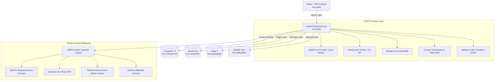
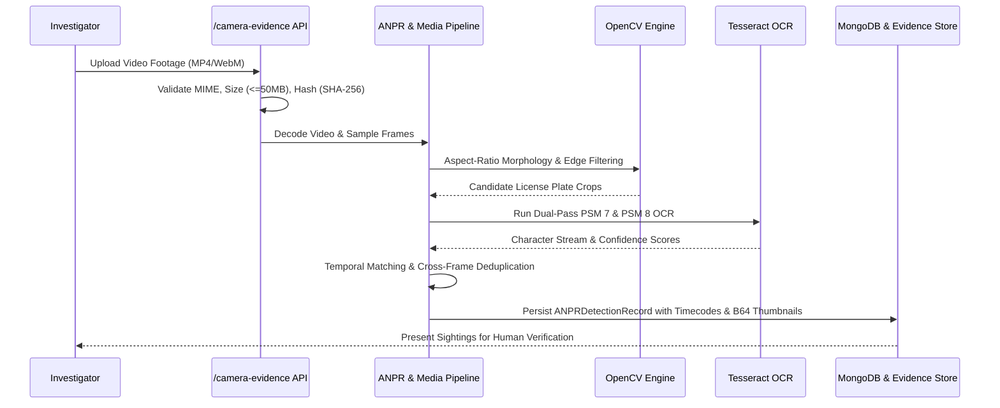

# Integration Architecture

## 1. System Overview

The Sential Intelligence Platform combines structured OSINT providers, threat intelligence sources, deep-learning and computer-vision pipelines, and graph relationship modeling into a single multi-tenant investigator workspace.



---

## 2. OSINT Common Provider Interface

To maintain strict modularity and prevent vendor lock-in, all five OSINT tools implement the `BaseOSINTProvider` interface (`app/modules/osint/providers/base.py`):

```python
class BaseOSINTProvider(ABC):
    @property
    @abstractmethod
    def provider_id(self) -> str: ...

    @property
    @abstractmethod
    def display_name(self) -> str: ...

    @abstractmethod
    def check_availability(self) -> ProviderStatus: ...

    @abstractmethod
    async def execute_query(
        self, target: str, target_type: str, options: dict
    ) -> ToolExecutionResponse: ...

    @abstractmethod
    def normalize_results(self, raw_data: Any) -> List[NormalizedResult]: ...
```

### Provider Behavior Guidelines:
1. **SpiderFoot:**
   - Detects if `SPIDERFOOT_URL` is configured.
   - If configured: submits scan (`/startscan`), polls status (`/scanstatus`), retrieves results (`/scaneventresults`), and attributes module provenance to each event.
   - If not configured: returns `CONFIG_REQUIRED` status with clear configuration instructions. Never creates fake scans.
   - Passive profile enforced by default.
2. **theHarvester:**
   - Detects if `THEHARVESTER_URL` (worker) or local `theHarvester` binary is installed.
   - Restricts invocation to safe, validated domains (preventing shell injection).
   - Constrains data sources to passive providers (`crtsh`, `certspotter`, etc.).
   - Returns structured emails, hosts, IPs, and URLs normalized into `NormalizedResult` records.
3. **Shodan:**
   - Queries `internetdb.shodan.io` for keyless port, vuln, and CPE intelligence.
   - If `SHODAN_API_KEY` is provided, supplements with authoritative host data (`/shodan/host/{ip}`) including service banners and SSL certificates.
   - Strictly separates internet device metadata from video camera assumptions.
4. **Google Dorks:**
   - Generates investigator-curated search query strings using advanced Google operators (`site:`, `filetype:`, `intitle:`, `inurl:`, `OR`, `-exclude`).
   - For `scope="news"`: executes queries legitimately against Google News RSS, returning real parsed articles without violating search engine terms.
   - For `scope="web"`: delivers pre-compiled, syntax-highlighted search query links for the analyst to review directly in their browser.
5. **Maltego:**
   - Normalizes investigation graph nodes and edges into RFC-4180 CSV tables matching Maltego's Table Import wizard.
   - Maps platform entity types (`person`, `domain`, `ip`, `email`, `vehicle`, etc.) into native `maltego.*` entity taxonomy.
   - Exposes endpoint for live Maltego local Transform XML/JSON dispatch.

---

## 3. Media Ingestion & Computer Vision Pipeline



---

## 4. Security & Safety Architecture

1. **Subprocess Isolation:** theHarvester and external tools are invoked either via dedicated HTTP workers or strictly validated argument arrays (`subprocess.run(["theHarvester", "-d", clean_domain])`) with no shell interpolation (`shell=False`).
2. **SSRF Guard:** Media URLs and camera streams pass through `app/core/network_safety.py`, blocking RFC 1918 private IPs, loopbacks (`127.0.0.1`), link-local addresses (`169.254.169.254`), and internal cloud metadata endpoints.
3. **Audit Trail:** Every provider execution, video ingestion, and manual plate verification records tenant ID, user ID, timestamp, and target hash in MongoDB collection `audit_logs`.
