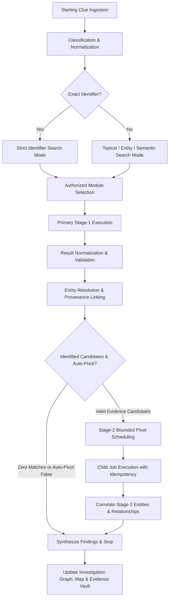

# Investigation Orchestration Design: Multi-Stage Clue-to-Clue Engine

## 1. Overview & Architectural Purpose

The Sential Investigation Platform implements a unified, evidence-driven, multi-stage investigative engine. Rather than executing disjointed single-pass OSINT or Threat Intelligence queries, the platform accepts any supported starting clue (phone, email, person/alias, username, vehicle plate, domain/IP, media, news incident, location) and dynamically progresses through multi-hop discovery chains while preserving complete evidentiary provenance and bounded execution safety.

---

## 2. Investigation Pipeline Stages

1. **Ingestion & Validation**:
   - Starting clue is received at a unified endpoint (`/api/v1/search` or `/api/v1/investigations`).
   - Query string is trimmed and passed through deterministic regex / syntax validators.
   - For emails: RFC 5322 syntax validation, domain lowercased, local-part preserved.
   - For phones: ITU-T E.164 parsing via `phonenumbers`, region prefix validation.
   - For vehicle plates: jurisdiction format matching (US, UK DVLA, India VAHAN, EU standard).

2. **Target Classification**:
   - The query intent is classified deterministically without ambiguous fallbacks.
   - Identifiers (email, phone, vehicle plate) lock the execution into `EXACT_IDENTIFIER` search mode, completely disabling semantic or fuzzy fallback to prevent false positive matches.

3. **Multi-Layer Authorization & Entitlement Check**:
   - Super Admin has platform-wide access to all enabled modules.
   - Tenant Admins and Analysts have access restricted to tenant-entitled modules (`EntitlementService`) and assigned modules (`UserRecord.assigned_modules`).
   - Platform-level module availability is checked in `ModuleRegistry.is_module_enabled()`. Disabled or unconfigured plugins are rejected immediately.

4. **Primary Stage-1 Execution**:
   - Context is packaged into `SearchContext` with trace ID, user ID, tenant ID, and query options.
   - Modules execute concurrently under `JobManager` supervision with per-job timeout budgets.
   - Normalized results return entities, relationships, evidence records, and execution telemetry.

5. **Entity Resolution & Provenance Preservation**:
   - Discovered candidate entities are normalized by type and value.
   - For exact identifiers, candidate records undergo server-side verification: a record must explicitly match the queried identifier in a supported contact field; incidental appearance in article text is strictly rejected.
   - All relationships carry explicit evidentiary basis (`DIRECT_OBSERVATION`, `EXPLICIT_SOURCE_STATEMENT`, `SOURCE_REPORTED`, `POSSIBLE_ASSOCIATION`).

6. **Candidate Pivot Generation**:
   - `PivotDiscoveryEngine` analyzes correlated entities and identifies actionable secondary hops (e.g., Domain -> IP -> Subdomains -> Public Repositories).
   - Candidate pivots contain:
     - `pivot_id`: Unique deterministic hash.
     - `pivot_query`: Normalized query for the next stage.
     - `pivot_target_type`: Target entity type.
     - `relationship`: Explicit edge type connecting parent to child.
     - `parent_entity_value`: Upstream clue that yielded this candidate.
     - `why_it_matters`: Forensic justification explaining why the hop is warranted.
     - `confidence`: Confidence score inherited from underlying evidence.

7. **Bounded Stage-2 Auto-Pivot Execution**:
   - When auto-pivot is enabled and stage-1 discovered verified entities, the engine executes up to configured maximum hops (default: 2 hops, maximum 2 candidate pivots).
   - Self-querying and previously visited queries are deduplicated.
   - Child jobs inherit `parent_job_id` and `hop_depth=2`.
   - Results are non-destructively correlated into the parent investigation, linking child entities to their parent entity with `RelationshipPayload`.

---

## 3. Execution Safety & Bounding Rules

To prevent uncontrolled recursion, denial of service, or quota exhaustion, the engine strictly enforces the following hard constraints:

| Parameter | Default Value | Hard Maximum | Description |
| :--- | :--- | :--- | :--- |
| **Max Hop Depth** | 2 | 3 | Maximum levels of automated recursive pivoting from the root clue |
| **Max Stage-2 Pivots** | 2 | 5 | Maximum number of child queries executed per investigation |
| **Per-Job Timeout** | 5.0 seconds | 15.0 seconds | Individual module child execution timeout |
| **Total Pipeline Timeout** | 30.0 seconds | 60.0 seconds | Global ceiling for synchronous investigation responses |
| **Deduplication Key** | `query_lower + target_type` | N/A | Prevents redundant lookups on previously examined targets |
| **Exact Identifier Zero-Match** | Immediate Stop | Immediate Stop | Nonexistent email/phone returns 0 matches; auto-pivot is halted |

---

## 4. Truthful Execution Statuses

Module and provider executions never report false success. The engine assigns standardized statuses:

- `SUCCESS`: Valid findings were discovered and verified.
- `SUCCESS_EMPTY`: Provider executed cleanly but no matching records were found.
- `PARTIAL`: Provider returned truncated or partial evidence due to source limitations.
- `FAILED`: Provider threw an unrecoverable exception or connection error.
- `CONFIG_REQUIRED`: Provider lacks required API credentials or tokens (e.g., DMV or commercial threat intelligence).
- `AUTH_REQUIRED`: Provider requires active investigator login or session credentials.
- `RATE_LIMITED`: Provider rejected query due to upstream API quota exhaustion.
- `RESTRICTED`: Query is legally or technologically restricted (e.g., private account or lawful interception).
- `SKIPPED`: Provider was bypassed due to missing capabilities or authorization bounds.
