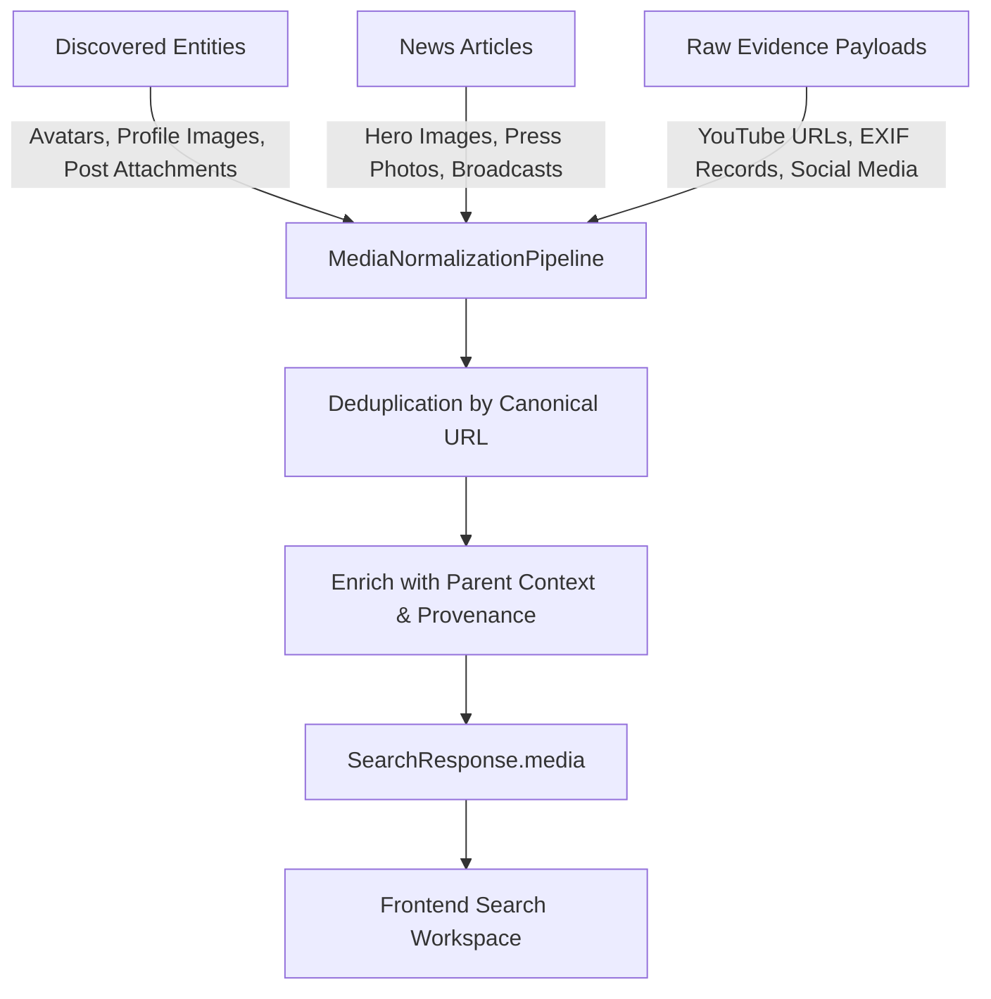

# Media Results, Images & Videos Architecture

## 1. Overview and Core Objective

In previous iterations of the platform, visual media (profile avatars, news article images, YouTube video broadcasts, and social posts) were scattered across separate modules, nested inside raw JSON evidence, or hidden behind multiple clicks.

Under the Investigator-First UI Refactor:
1. **Immediate Visibility**: The moment an investigator queries a target, discovered images and videos are surfaced directly in the search results navigation via dedicated **Images** and **Videos** tabs.
2. **First-Class Contracts**: Visual assets are structured into normalized `MediaRecord` entities with strict provenance, parent entity associations, verification states, and SHA-256 evidence links.
3. **No Fabricated Media**: If a target has no visual records, an informative zero-state is shown detailing which sources were evaluated and why zero media was found.

---

## 2. Media Extraction Pipeline (`MediaNormalizationPipeline`)

Located at `backend/app/search/media_extractor.py`, the normalization pipeline extracts media from three main tiers:

### Supported Media Types
- `image`: Supported formats include JPEG, PNG, WebP, SVG, and public CDN URLs.
- `video`: Supported formats include YouTube video embeds (`youtube.com/watch?v=`, `youtu.be/`), MP4/WebM video streams, and video platform broadcasts.

---

## 3. Frontend UI Components

### A. Dedicated Tabs in Search Results Area
- **Images Tab (`ImagesTab.tsx`)**:
  - Responsive grid layout (1 to 4 columns depending on viewport).
  - Displays image preview with automatic fallback for broken URLs.
  - Source platform badge (e.g. GitHub, Twitter, Reuters, WHOIS).
  - Parent context label (e.g., "Jane Doe Profile Image", "Facility Recon").
  - Publication and collection timestamps.
  - Verification badge (`VERIFIED`, `UNVERIFIED`).
  - Search and platform filter bar.

- **Videos Tab (`VideosTab.tsx`)**:
  - Video card grid with prominent play overlay.
  - Video title, channel/publisher, and duration.
  - Platform badge (YouTube, Vimeo, News Wire).
  - Transcript availability indicator.
  - Direct external link to source broadcast.

### B. Interactive Accessible Modal Viewer (`MediaViewerModal.tsx`)
- Full-screen accessible modal (`role="dialog"`, `aria-modal="true"`).
- Keyboard support (`Escape` to close, accessible tab focus).
- Embedded YouTube player iframe for instant playback without leaving the investigation.
- Native HTML5 video player for direct video streams.
- Full-resolution image zoom and inspection.
- Comprehensive metadata panel displaying:
  - Source provider & platform
  - Parent entity & investigation case ID
  - Publication timestamp
  - Collection timestamp
  - Cryptographic SHA-256 evidence hashes with 1-click clipboard copy
  - Direct canonical source hyperlink

---

## 4. Verification and Testing

Automated test suite `backend/tests/test_media_intelligence_contracts.py` validates:
- Image extraction from person, profile, and article entities.
- YouTube URL normalization and ID extraction.
- Deduplication of identical media URLs across multiple sources.
- Retention of cryptographic evidence hashes.
- Proper serialization within `SearchResponse`.
