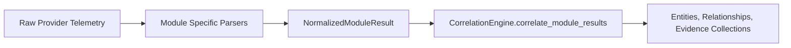
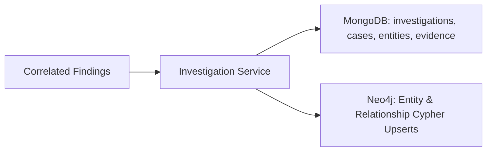
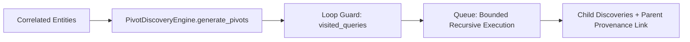
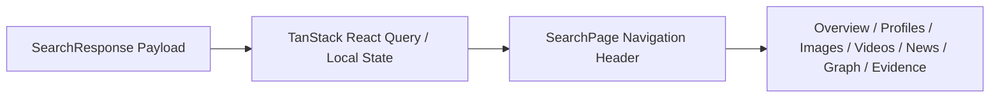
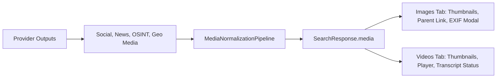
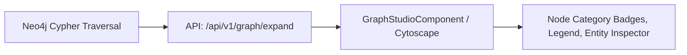

# Codebase Baseline Audit & Dependency Analysis

**Date:** October 17, 2026  
**Repository:** `/home/songoku/Pictures/Intelligence`  
**Baseline Git Commit:** `b9ea58f19bd51748d5fbf842515b6c016549fec5`  
**Branch:** `feat/safe-codebase-refactor-investigator-ui`  
**Test Baseline:** 188 / 188 Backend Tests Passing (100%), 25 / 25 Frontend Assertions Passing  

---

## 1. Executive Summary

This audit establishes an evidence-based inventory of the Sentinel Intelligence platform prior to code refactoring and UI improvements. The application possesses robust modular capabilities spanning OSINT, Threat Intelligence, Social Media Intelligence, News Intelligence, and Geo Intelligence, supported by dual persistence (MongoDB and Neo4j), deterministic universal classification, and bounded recursive pivoting.

However, several critical structural issues, UI accessibility hurdles, and media surfacing gaps were identified:
1. **Media Accessibility Gap:** Media records (Images and Videos) are parsed internally by individual modules but are **not surfaced as first-class tabs** in the search results area. Investigators had to drill down into raw JSON evidence or the News tab to view videos, while images had no dedicated tab.
2. **Search Page Monolith:** `frontend/src/features/search/SearchPage.tsx` spans **2,512 lines** containing search bar, filters, 9 tab views, export logic, and inline rendering of findings, profiles, news, and graph.
3. **Tab Hierarchy Inconsistency:** Results navigation did not adhere to the required investigator standard: `Overview`, `All Results`, `Profiles`, `Images`, `Videos`, `News`, `Infrastructure/Threats`, `Locations`, `Evidence`.
4. **Backend Media Normalization Gap:** `SearchResponse` lacked a dedicated `media: List[MediaRecord]` contract, requiring frontend to inconsistently pluck media URLs from various evidence subfields.
5. **Investigator Usability (Users Over 40):** Several cards had small typography (10-11px), ambiguous icons, and required multiple clicks to inspect source evidence.

---

## 2. Dependency Maps for Critical Flows

### Flow 1: Search Request to Provider Execution

```mermaid
flowchart LR
    A[Investigator Query] --> B[API: POST /api/v1/search]
    B --> C[TargetClassifier.classify_intent]
    C --> D[Ambiguity Guard / 15 Target Types]
    D --> E[classify_query_intent_and_mode]
    E --> F[AuthorizationService / Tenant Entitlements]
    F --> G[Provider Discovery & 10-State Lifecycle]
    G --> H[Module Execution via JobManager.run_async_job]
```

### Flow 2: Provider Output to Normalized Result

### Flow 3: Result to Persistence

### Flow 4: Discovered Entity to Follow-up Investigation

### Flow 5: Search Results to Investigation Workspace

### Flow 6: Media Extraction to Images and Videos Tabs (Identified Gap & Target)

### Flow 7: Persisted Relationships to Graph Visualization

### Flow 8: Geographic Evidence to Map and Timeline

---

## 3. Findings & Technical Debt Inventory

| ID | Category | Severity | File(s) Affected | Description | Recommended Refactor Action |
|---|---|---|---|---|---|
| **F-01** | Feature Gap | **HIGH** | `frontend/src/features/search/SearchPage.tsx`, `backend/app/search/schemas.py` | Images and Videos are not first-class search result tabs. | Define `MediaRecord` backend schema, populate in orchestrator, implement dedicated `ImagesTab` and `VideosTab` in search results. |
| **F-02** | Code Structure | **MEDIUM** | `frontend/src/features/search/SearchPage.tsx` | Monolithic component (2,512 lines) containing all tab renderers. | Decompose into modular tab components under `frontend/src/features/search/components/`. |
| **F-03** | UI / Hierarchy | **MEDIUM** | `SearchPage.tsx` | Results navigation header did not follow the required compact layout: `Overview`, `All Results`, `Profiles`, `Images`, `Videos`, `News`, `Infrastructure/Threats`, `Locations`, `Evidence`. | Refactor tab header to exact required sequence with real badge counts. |
| **F-04** | Usability | **MEDIUM** | Search result cards | Small text, low-contrast metadata, ambiguous click targets. | Upgrade typography to 14-16px base, clear high-contrast badges, fewer clicks. |
| **F-05** | State Management | **LOW** | `SearchPage.tsx` | Multiple scattered useState hooks for pagination and modal state. | Consolidate search results state and ensure consecutive searches cleanly reset stale results. |
| **F-06** | Media Model | **HIGH** | `backend/app/search/schemas.py`, `backend/app/search/orchestrator.py` | Lack of unified media extraction contract. | Introduce `MediaRecord` model in schemas and extract from all providers in correlation step. |

---

## 4. Preservation Invariants

The following existing capabilities must be preserved without disruption:
- 100% of the 188 existing backend tests must continue to pass.
- Deterministic universal target classification for all 15 target categories.
- 10-state provider lifecycle reporting (`NOT_ATTEMPTED` through `SKIPPED_WITH_REASON`).
- Multi-tenant data isolation and RBAC.
- Dual persistence to MongoDB and Neo4j.
- Truthful data integrity: zero fabricated cameras, coordinates, subscribers, or 100% fake confidences.
