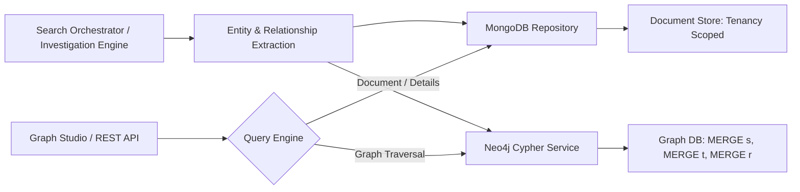

# Dual-Store Relationship Graph Architecture & Persistence

## 1. Overview & Dual-Store Topology

Sential utilizes an active dual-store persistence architecture for entity relationship graphs:

1. **MongoDB (`relationships` collection & `RelationshipRepository`)**:
   - Primary document store providing document-level transaction support, multi-tenant BSON isolation, fast JSON serialization for REST APIs, and cold-storage archiving.
   - Synchronous fallback to in-memory cache guarantees complete availability in containerized or low-connectivity test environments.
2. **Neo4j Enterprise Graph Engine (`Neo4jGraphService`)**:
   - High-performance labeled property graph engine executing directed Cypher queries for bounded 1-hop traversal, multi-hop subgraphs, shared node identification, and visual investigative layouts.



---

## 2. Automated Search-to-Graph Dual Persistence

In earlier versions, relationships discovered during search runs were held only in response objects or investigation metadata without being written to the underlying relationship graph.

In the remediated pipeline, **every search execution automatically dual-persists all entities and relationships** immediately upon search completion:

### Entity Upsert Workflow
1. Discovered entities are assigned deterministic unique IDs (`ent_{type}_{value}` or `ent_{hash}`).
2. MongoDB writes the entity document with tenant isolation key (`tenant_id`).
3. Neo4j executes idempotent Cypher upsert:
   ```cypher
   MERGE (e:Entity {id: $id, tenant_id: $tenant_id})
   SET e.value = $value,
       e.type = $type,
       e.confidence = $confidence,
       e.sources = $sources,
       e.metadata = $metadata,
       e.last_seen = datetime()
   RETURN e.id AS id
   ```

### Relationship Upsert Workflow
1. Directed typed relationships are assigned unique IDs (`rel_{source}_{target}_{type}`).
2. MongoDB writes to `RelationshipRepository` (`relationship_repo._sync_write` and `memory_cache.relationships`).
3. Neo4j executes Cypher merge ensuring both endpoint nodes exist before constructing the directed edge:
   ```cypher
   MERGE (s:Entity {id: $src_id, tenant_id: $tenant_id})
   ON CREATE SET s.value = $src_id, s.type = 'entity', s.last_seen = datetime()
   MERGE (t:Entity {id: $tgt_id, tenant_id: $tenant_id})
   ON CREATE SET t.value = $tgt_id, t.type = 'entity', t.last_seen = datetime()
   MERGE (s)-[r:REL_TYPE {id: $rel_id, tenant_id: $tenant_id}]->(t)
   SET r.confidence = $confidence,
       r.basis = $basis,
       r.is_inferred = $is_inferred,
       r.evidence_ids = $evidence_ids,
       r.source = $source,
       r.investigation_id = $inv_id,
       r.last_seen = datetime()
   RETURN r.id AS id
   ```

---

## 3. Strict Canonical Relationship Type Allowlist

To prevent Cypher injection while preserving the full semantic vocabulary of forensic analysis, `Neo4jGraphService._sanitize_rel_type` enforces an exhaustive allowlist based on the `RelationshipType` enum:

| Canonical Edge Type | Purpose & Forensic Meaning |
| :--- | :--- |
| `OWNS` / `REGISTERED_TO` | Direct property or asset ownership |
| `CONNECTED_TO` | Non-exclusive correlation or network link |
| `AFFILIATED_WITH` | Organizational or group membership |
| `COMMUNICATED_WITH` | Direct verified communication (email, telecom) |
| `OPERATES` / `CONTROLS` | Infrastructure or account control |
| `RESOLVES_TO` / `HOSTED_ON_IP` | DNS resolution and virtual host hosting |
| `LOCATED_AT` / `OBSERVED_AT` | Geospatial point observation |
| `ALIASED_AS` | Username, moniker, or identity alias |
| `ASSOCIATED_WITH` | Entity association established by official record |
| `HAS_VULNERABILITY` | Software / firmware CVE mapping |

Any string outside this canonical enum is safely mapped to `RELATED_TO`.

---

## 4. Bounded 1-Hop Traversal & API Expansion

Forensic investigations require strictly bounded exploration. Unbounded multi-hop graph expansions cause cognitive overload and browser performance degradation.

The `/api/v1/entities/{id}/expand` and `/api/v1/graph/expand` endpoints enforce:
1. **Bounded Hop Depth**: Exactly 1 hop from the seed node. Connected nodes are returned; 2-hop grandchildren are excluded unless explicitly clicked.
2. **Confidence Filtering**: `min_confidence` filters noisy or tentative correlations.
3. **Type Filtering**: `relationship_types` query parameter restricts traversal to specified edge classifications.
4. **Tenant Isolation**: Graph traversals are strictly filtered by `tenant_id` ensuring zero cross-tenant data leakage.
5. **Fallbacks**: If Neo4j is offline or in maintenance, the endpoint gracefully falls back to MongoDB `RelationshipRepository.expand_entity_1hop()`.

---

## 5. Evidence Provenance & Confidence Transparency

- Relationships link directly to supporting evidence via `evidence_ids: List[str]`.
- Investigators inspecting an edge in the UI can click **View Evidence** to inspect raw payloads, provider traces, and cryptographic hashes.
- Confidence scores reflect authentic evidentiary certainty:
  - Direct observation: `0.90 - 1.0`
  - Automated prefix/format inference: `0.70 - 0.80`
  - Heuristic / tentative lead: `< 0.60`
  - Unrated entities: honestly displayed as `Unrated Confidence` badge rather than fabricated percentages.
