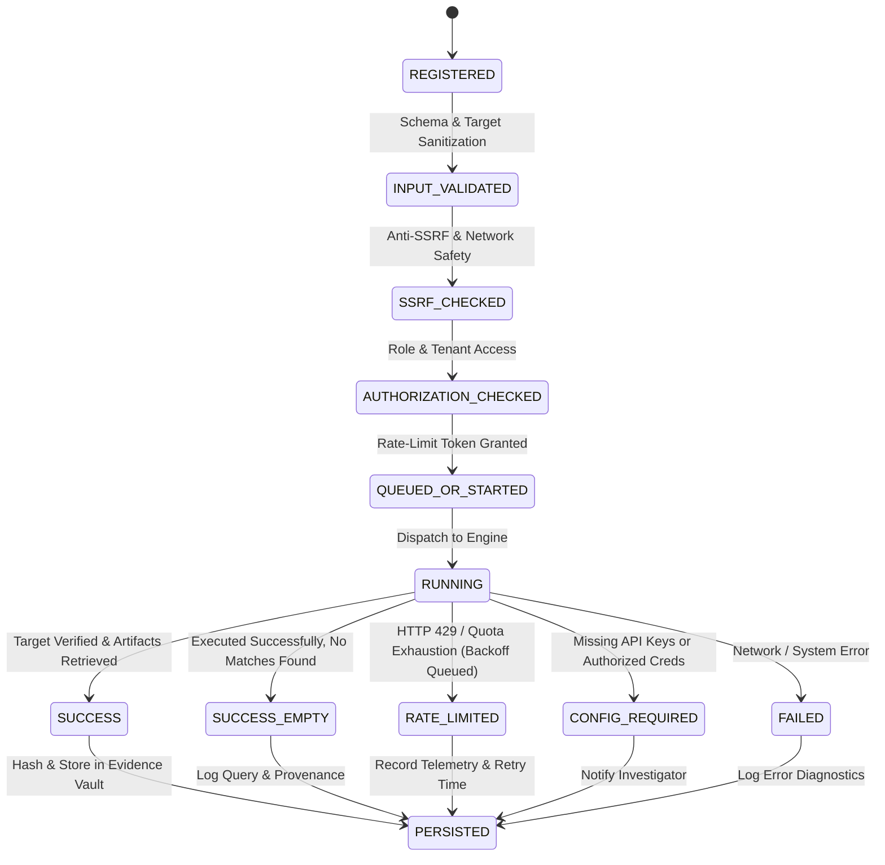

# Architectural Assessment & Target State Architecture

**Target Repository:** `/home/songoku/Pictures/Intelligence`  
**Architecture Review Date:** October 2026  
**Standards:** High-Assurance Investigative Systems, OWASP ASVS, Defence-Sector Provenance Standards.

---

## 1. Current Architecture vs. Target State

### Current State
```
┌─────────────────────────────────────────────────────────────┐
│                     React 18 Frontend                       │
│ (News Intelligence, Social Recon, Investigations, Timeline) │
└──────────────────────────────┬──────────────────────────────┘
                               │ REST / OpenAPI
┌──────────────────────────────▼──────────────────────────────┐
│                    FastAPI Backend Core                     │
├──────────────────────────────┬──────────────────────────────┤
│ News Intelligence            │ Social Media Intelligence    │
│ - RSS / GDELT / YouTube      │ - Unmanaged HTTP per adapter │
│ - [VULN] Fallback Synthesis  │ - [VULN] Fallback Fake Posts │
├──────────────────────────────┼──────────────────────────────┤
│ Tool Executor                │ Dossier & Graph Services     │
│ - Ad-hoc probers             │ - Static entity links        │
│ - [VULN] Fake 0.98 Conf      │ - Single-pass timeline       │
└──────────────────────────────┴──────────────────────────────┘
```

**Weaknesses in Current Architecture:**
1. **Coupling of Collection & Presentation:** Components generate placeholder/mock data when external endpoints fail to satisfy frontend display expectations.
2. **Missing Crawler Middleware:** No rate-limit governor, no token bucket, no retry queue, and no cursor checkpointing.
3. **Inconsistent Tool Contracts:** Tools return varied dictionary payloads and arbitrary confidence scores without proof of target existence.
4. **Vague Provenance:** Claims, articles, and entities are sometimes linked without explicit basis or observation methodology.

---

## 2. Target High-Assurance Architecture

```
┌─────────────────────────────────────────────────────────────────────────┐
│                           Frontend (Vite / React)                       │
│  - Honest Provider Telemetry  - Explicit Uncertainty & Disputed Claims  │
│  - Resumable Crawl Controls   - Direct Provenance Inspection Link       │
└────────────────────────────────────┬────────────────────────────────────┘
                                     │
┌────────────────────────────────────▼────────────────────────────────────┐
│                             API Gateway & RBAC                          │
│  - Tenant Isolation  - Audit Logging  - Strict Input / SSRF Validation  │
└──────────────────┬───────────────────────────────────────┬──────────────┘
                   │                                       │
┌──────────────────▼──────────────────┐ ┌──────────────────▼──────────────┐
│     News Intelligence Engine        │ │ Resilient Social Crawler Engine │
│  - Authentic Multi-Wire Fetchers    │ │  - Adaptive 429 Token Bucket    │
│  - Strict Zero-Synthesis Honesty    │ │  - Exponential Jitter Backoff   │
│  - Claim Extraction & Verification  │ │  - Cursor State Checkpointing   │
│  - Source Independence Scoring      │ │  - Platform Circuit Breakers    │
└──────────────────┬──────────────────┘ └──────────────────┬──────────────┘
                   │                                       │
┌──────────────────▼───────────────────────────────────────▼──────────────┐
│                        Evidence & Provenance Core                       │
│  - Immutable Evidence Payload Vault (SHA-256 Content Addressing)        │
│  - Structured Claims (Supported, Disputed, Unverified, Missing Evidence)│
│  - Attributed Graph (Direct Observed vs. Inferred with Uncertainty)     │
└────────────────────────────────────┬────────────────────────────────────┘
                                     │
┌────────────────────────────────────▼────────────────────────────────────┐
│                    Persistence & External Boundaries                    │
│  - MongoDB (Multi-Tenant Documents, Evidence Vault, Audit Trails)       │
│  - ML Team Contract Boundary (Strict schemas, zero mock predictions)    │
└─────────────────────────────────────────────────────────────────────────┘
```

---

## 3. Standardized Tool Execution Lifecycle

Every intelligence tool and external collector must adhere to a standardized, deterministic lifecycle:



### Execution Status Standardization
- `SUCCESS`: Tool completed real network execution; target and authentic artifacts confirmed.
- `SUCCESS_EMPTY`: Tool ran legitimately; verified that no public records match the query.
- `RATE_LIMITED`: Provider returned HTTP 429 or quota limit; retry-after timestamp parsed.
- `CONFIG_REQUIRED`: External platform requires official credentials/keys not currently configured.
- `UNAVAILABLE`: Provider is down or network unreachable.
- `FAILED`: Unhandled error during execution.

---

## 4. Evidence, Provenance & Claim Modeling

To answer the operational requirements ("What actually happened? Which sources support it? What is missing?"):

### A. The Evidence Object
```json
{
  "evidence_id": "ev_a9f14b28",
  "source_url": "https://authentic-wire.com/article/10492",
  "source_domain": "authentic-wire.com",
  "content_hash_sha256": "e3b0c44298fc1c149afbf4c8996fb92427ae41e4649b934ca495991b7852b855",
  "retrieval_timestamp": "2026-10-14T07:15:00Z",
  "collector_module": "news_wire_rss",
  "raw_artifact_length": 8420,
  "verification_status": "AUTHENTIC_RETRIEVAL"
}
```

### B. Claim-Centric Record
Rather than labeling an entire article or topic as "Misinformation" or "Truth", claims are isolated:
- **Claim Statement:** Exact factual proposition made by the source.
- **Attributed Speaker / Source:** Who stated it.
- **Corroborating Evidence:** Independent sources reporting the same direct observation.
- **Disputing / Qualifying Evidence:** Independent sources presenting conflicting facts.
- **Syndication Relationship:** Outlets repeating the initial source without independent reporting.
- **Analyst Assessment:** Explicit rationale with certainty grade (`CONFIRMED`, `PROBABLE`, `UNVERIFIED`, `CONTRADICTED`).

---

## 5. Security & Boundary Guardrails

1. **Anti-SSRF Protection:** Enforced through a centralized `NetworkSafetyValidator` before any HTTP request. Disallows loopback (`127.0.0.0/8`, `::1`), link-local (`169.254.0.0/16`), and private subnets (`10.0.0.0/8`, `172.16.0.0/12`, `192.168.0.0/16`).
2. **AI/ML Team Ownership Boundary:** The core application performs deterministic extraction and structured normalization. It emits clean inputs and expects structured inference schemas adhering to `ML_TEAM_INTEGRATION_CONTRACT.md`. No mock predictions or synthetic summaries may be inserted in place of an offline ML service.
