# Implementation Roadmap — Intelligence Platform Transformation

**Target Repository:** `/home/songoku/Pictures/Intelligence`  
**Execution Horizon:** 10 Phases in Strict Dependency Sequence  
**Branch:** `feat/platform-transformation`

---

## Roadmap Overview

```mermaid
gantt
    title Platform Transformation Sequence
    dateFormat  X
    axisFormat %s
    section Phase 1: Audit
    Baseline Audit & Architecture Assessment :done, p1, 0, 1
    section Phase 2: Core
    Tool Execution Lifecycle & Status Normalization :active, p2, 1, 2
    section Phase 3: News
    Eliminate Synthesis & Enhance Real Wire Retrieval :p3, 2, 3
    section Phase 4: Social
    Adaptive Crawler Engine (429, Backoff, Cursors) :p4, 3, 4
    section Phase 5: Graph
    Entity & Timeline Relationship Attribution :p5, 4, 5
    section Phase 6: ML Contract
    Preserve ML Boundary & Pure Schemas :p6, 5, 6
    section Phase 7: Security
    Anti-SSRF, Subprocess & Audit Controls :p7, 6, 7
    section Phase 8: UI
    Frontend Provider Diagnostics & Provenance Links :p8, 7, 8
    section Phase 9: QA
    Comprehensive Pytest & Integration Verification :p9, 8, 9
    section Phase 10: Handover
    Production Readiness & Engineering Handover :p10, 9, 10
```

---

## Detailed Phase Breakdown

### Phase 1: Baseline Audit & Gap Analysis [COMPLETED]
- [x] Complete code inspection across all backend modules, collectors, tool executors, frontend pages.
- [x] Identify fake article synthesis, fake social posts, and unverified profile assertions.
- [x] Publish `BASELINE_AUDIT.md`, `ARCHITECTURE_ASSESSMENT.md`, and `IMPLEMENTATION_ROADMAP.md`.

### Phase 2: Core Intelligence Architecture & Tool Execution Standardization [IN PROGRESS]
- [ ] Standardize `ToolExecutionResponse` statuses: `SUCCESS`, `SUCCESS_EMPTY`, `RATE_LIMITED`, `CONFIG_REQUIRED`, `UNAVAILABLE`, `FAILED`.
- [ ] Refactor `backend/app/modules/tool_executor.py` to eliminate false-positive `SUCCESS` claims on unverified usernames.
- [ ] Enforce true HTTP verification on username and social profile probes; handle errors and timeouts as `UNKNOWN` or `FAILED`.
- [ ] Establish immutable evidence payload registration for all valid tool executions.

### Phase 3: News Intelligence Transformation
- [ ] Remove `_synthesize_resilient_query_records()` from `backend/app/modules/news_intelligence/search_engine.py`.
- [ ] Return honest `total_results = 0` with granular provider diagnostics when queries return no authentic matches.
- [ ] Implement deterministic claim isolation: distinguish factual claims from commentary.
- [ ] Improve cross-source deduplication and distinguish syndicated repetition from independent corroboration.
- [ ] Author `docs/transformation/NEWS_INTELLIGENCE_IMPROVEMENTS.md` including DisinfoLab comparative evaluation.

### Phase 4: Social Media Intelligence Crawler Optimization
- [ ] Author `docs/transformation/SOCIAL_MEDIA_CRAWLER_AUDIT.md`.
- [ ] Author `docs/transformation/SOCIAL_MEDIA_CRAWLER_DESIGN.md`.
- [ ] Excise `_generate_fallback_posts` from Bluesky, Telegram, Reddit, Mastodon, and YouTube collectors.
- [ ] Excise hardcoded telemetry metrics and fabricated comments from `youtube.py`.
- [ ] Implement `ResilientCrawlerEngine` with:
  - Adaptive HTTP 429 throttling and `Retry-After` header extraction.
  - Exponential backoff with randomized jitter.
  - Pagination cursor state checkpointing and resumability.
  - Per-platform circuit breaking and concurrency limiting.
  - Structured collector status codes (`QUOTA_EXCEEDED`, `ACCESS_DENIED`, etc.).
- [ ] Author `docs/transformation/SOCIAL_MEDIA_CRAWLER_TESTS.md`.

### Phase 5: Entity, Relationship & Timeline Analysis
- [ ] Ensure graph links distinguish `DIRECT_OBSERVATION` from `INFERRED_RELATIONSHIP`.
- [ ] Attach explicit confidence, observation methodology, and uncertainty metadata to all graph edges.
- [ ] Prevent co-occurrence from being labeled as coordinated narrative without supporting corroboration.

### Phase 6: AI/ML Ownership Boundary
- [ ] Verify that no internal LLM/AI models or prompt chains are reintroduced.
- [ ] Validate strict input/output contract compliance against `docs/migration/ML_TEAM_INTEGRATION_CONTRACT.md`.
- [ ] Ensure all analytical workflows function deterministically and honestly when ML inference is offline.

### Phase 7: Security & High-Assurance Engineering
- [ ] Verify comprehensive anti-SSRF filtering on all URL fetching and article parsing.
- [ ] Validate input sanitization on command and subprocess invocations.
- [ ] Maintain audit trails for evidence access and sensitive investigation queries.

### Phase 8: Frontend Investigator Experience
- [ ] Update News Intelligence UI to render honest provider error and empty states.
- [ ] Update Social Media collection UI to surface real crawler statuses, 429 backoff countdowns, and quota alerts.
- [ ] Ensure clickable provenance links navigate directly to verifiable source artifacts and hashes.

### Phase 9: Testing & Validation
- [ ] Run backend unit and integration tests (`pytest backend/tests/ -v`).
- [ ] Add tests for crawler rate-limiting, 429 backoff, cursor resumption, and zero-synthesis honesty.
- [ ] Validate frontend build and typecheck (`npm run typecheck && npm run build`).

### Phase 10: Production Readiness & Final Handover
- [ ] Document production configuration, secrets management, and recovery procedures.
- [ ] Deliver comprehensive engineering handover report matching Section 15 specifications.
